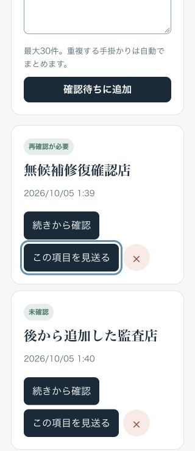

# A01–A12 落地成果全面审核

完成日期：2026-10-05（日本时间）。审核对象为当前未提交工作副本；不是已部署版本。对照 [开发清单](./next-feature-roadmap.md)、[模块设计](./feature-module-designs.md) 及各模块契约，检查代码、测试、离线工具、跨页面操作和既有证据。

## 结论

A01–A12 的约定本地工程范围已落地，但此前的通过测试未覆盖全部跨流程风险。本次重新复跑原有 602 项测试后，仍发现 **2 项 P1、2 项 P2**；现已全部修复，最终 **608/608 测试通过，0 失败、0 跳过**。两个前端问题在 Codex in-app Browser 中完成修复前复现与修复后验证。

在本次检查范围内，没有剩余的已确认阻断问题。这个结论不代表无缺陷，也不代表已经具备真实业务、供应商质量或发布证据。A08 的研究准备、A12 的内存模型与真实经营功能有明确边界；B/C/D 的 19 个条件任务仍保留，不应称为全部产品开发完成。

## 发现、影响与修复

### F01 / P1：示例体验覆盖真实待办

触发：待办搜索无候选 → 进入“操作サンプル” → 确认示例门店。原实现保留 `activePendingId`，示例完成会把原待办标为 completed，并以示例线索覆盖原草稿。页面上原“無候補監査店”变为“銀座 鮨 蒼月”，未完成数从 1 变为 0。

修复：[app.js](../src/app.js) 的 `openExampleExperience` 先保存并脱离原任务，再重置当前搜索及测量状态。失败任务保留 failed、失败阶段和原草稿，示例不再关联其完成动作。

验证：修复后重新执行上述完整链路，“無候補修復確認店”仍显示“再確認が必要”，未完成数保持 1；随后刷新仍保留。[修复前](./evidence/a-stage-comprehensive-audit/queue-before.png)／[修复后](./evidence/a-stage-comprehensive-audit/queue-after.png)。截图中的旧完成项是修复前留下的合成记录，不是修复后新完成的任务。

### F02 / P1：撤销删除丢失后来新增或编辑的记录

触发：删除 A → 新增 B → 撤销。原实现把整个域的旧数组写回，B 被删除，其他记录的新编辑也可能回退。此问题影响保存、历史和待办三域的共用撤销逻辑。

修复：[local-task-storage.js](../src/local-task-storage.js) 新增 `restoreDeletedTasks`；撤销仅携带被删除项，与当前列表合并。同 ID 的现有版本优先；合并会超容量或因重复线索遗漏记录时，拒绝整次恢复并显示说明，不覆盖或部分恢复。单项删除与批量移除只记实际删除项。

验证：新增三项回归，覆盖三域新增／编辑保留、10／30 条容量及重复队列线索；页面执行删除 → 新增 → 撤销后，新旧项同时存在，刷新仍保留。[修复前](./evidence/a-stage-comprehensive-audit/undo-before.png)／[修复后](./evidence/a-stage-comprehensive-audit/undo-after.png)。

### F03 / P2：不完整的实际工时被标为完整

触发：客户成本合成快照追加 60 分钟工时，但 taskId 无法归属。原报告已指出 `unallocatedWorkLogs=1`、费用不完整，仍返回 `completeActualMinutes=true`，仅显示已归属的 40 分钟小计；任务覆盖未知也可出现同类问题。

修复：[customer-cost-report.mjs](../server/customer-cost-report.mjs) 将任务覆盖、未归属任务／工时、任务／工时冲突及相关无效记录纳入分钟完整性判断。单纯缺少单价或账单不改变已知分钟的完整性，费用完整性仍单独计算。

验证：新增完整性和价格独立性回归；孤立工时、覆盖未知、冲突不再宣称完整分钟，缺价格仍保持真实分钟。原缺陷没有使 G1/GB 或完整贡献金额误通过。

### F04 / P2：交付验收允许时间倒退

触发：10 月 2 日生成草稿 → 10 月 3 日请求审阅 → 以 10 月 2 日中午记录验收。原模型只检查生成时间，允许此因果顺序；验收后的修订也能早于验收。

修复：[review-workflow.mjs](../server/review-workflow.mjs) 为交付状态保存并验证 `updatedAt`，请求、验收和修订均不得早于最后状态变更。内容 revision 与状态更新时间分开：请求／验收不提升内容版本，修订生成新版本并保留旧验收所属版本。

验证：新增回退验收、回退修订、合法递增时间、损坏时间及内容版本不变的回归。仍是 fixture-only；未启用真实客户交付或改变经营门槛。

## A01–A12 覆盖矩阵

| 任务 | 本次核对的实现与证据 | 判定和限制 |
| --- | --- | --- |
| A01 | CommercialEvent v2 白名单、流程／复核分离、事件与研究关联分开、撤销和保留契约；schema 回归 | 本地范围通过；不把外链或本人预约记录当成交 |
| A02 | 服务端流程能力、阶段观察、串行原子持久化、去重／冲突、同意到期／撤销、损坏和容量；实际回环 HTTP 集成测试 | 本地范围通过；仅一个 Node 写入进程，不代表跨进程数据库 |
| A03 | 客户端可选同意、超时／重试／会话、分析与主动复核关联；自然来源／成熟期／同批次／小样本切片 | 本地范围通过；自然来源注册表为空，真实成熟 R7 未建立 |
| A04 | 实际请求边界归属、失败和 fallback、上游加载与缓存受益分离、版本单价与未知成本；成本回归及离线汇总 | 本地范围通过；真实价格表为空，未知费用不能算零 |
| A05 | API／工时／客服／渠道／周期贡献、影子权益；专项与全量回归 | F03 已修复；真实账单、实际收入和权益事务尚无 |
| A06 | 独立计划 ID、白名单迁移、备份和首读失败保护、备注／搜索／自记进度、分域操作 | F02 已修复；原生下载回执仍未取得，现有可见 JSON 退路可用 |
| A07 | 批次、单项显式开始、暂停／失败恢复、终态计数、旧队列兼容；单元及页面验证 | F01/F02 已修复；不自动重跑整批，不保存原图 |
| A08 | 同版报价及访谈模板、兴趣／付费／交付／续购分层、受保护默认关闭接口、离线 G1/GB 计算 | 研究准备范围通过；未开展真实访谈、收费或启用报价卡 |
| A09 | 基线档案与 digest、provider-free 重放、协议与人工真值 schema | 基线重放 49 项测试及本地接口通过；真实候选和研究协议仍待冻结 |
| A10 | 30 案例／90 三路线合成任务、失败保留分母、缺时／版本／路线不全保护、保守 GQ | 工具通过；默认输出 `fixture_only`、GQ=false，无真人比较结论 |
| A11 | 各来源真实时间、缓存原时刻、缺失／非法时间、分店确认、纠错草稿、匹配计划复核、晚响应隔离 | 本地回归通过；没有新供应商联调或真实 iOS Safari 证据 |
| A12 | 字段×来源×目的许可、作用域／revision、冲突、任务、私有交付与验收；8/8 fixture 校验 | F04 已修复；真实持久化、运营身份、工作区与恢复属于后续条件范围 |

## 实际运行证据

- 最终 [全量测试日志](./evidence/a-stage-comprehensive-audit/full-tests.log)：608 通过、0 失败、0 跳过，包含实际本地 HTTP。受影响前端专项 46 项、成本／交付专项 32 项通过，均包含在最终全量中。
- [基线重放](./evidence/a-stage-comprehensive-audit/baseline-replay.json)：旧 revision `6c1e1567ebb796af2f8dd19e001f3550303fc2c0` 可运行，49 项回归及本地 health/capabilities 通过，付费调用为 0。
- `eval:validate`：35/35 人工案例记录结构有效；这不是重新人工确认真值，也不是当前改动的付费候选／决策评估。
- benchmark validate/summary、commercial、request costs、customer costs、offers、review 七项默认离线检查退出 0。全部为合成输入，输出保留无真实证据／门槛不足标志，未把样例数字转成经营结论。
- Codex in-app Browser：默认视口和 320×740；真实操作复现及复测 F01/F02，刷新后两条未完成记录及原合成完成项保持；320px 文档宽度为 320px，键盘 Tab 焦点可见、轮廓 3px，捕获 console warn/error 0。没有独立网络面板导出。
- 前端缓存版本提升到 v79。首次读取旧缓存后重载当前资源再验收；旧版本页面不能算当前实现证据。
- `node --check` 与 `git diff --check` 通过。完整文件范围、工作副本指纹和边界见 [机器可读记录](./evidence/a-stage-comprehensive-audit/verification.json)。本次代码指纹包含 237 个代码／配置／评估文件，不包含文档或运行时客户数据。

本轮先由主代理审查 A01–A03/A06–A07/A11 与跨流程；一个有界只读辅助审核覆盖成本、报价、基线／比较和复核模型，提交 F03/F04。辅助修复阶段因额度中断，主代理核对已有改动并完成专项、全量与最终验收；不把中断状态或审核意见当作验证通过。

## 遗漏与剩余边界

1. **之前漏测的路径已补上。** 原 602 项测试全绿仍不能发现示例与真实任务串联、撤销覆盖后续编辑。新增数据层回归并记录完整页面路径；今后修改相邻入口应重跑这两条用户路径。
2. **文档状态已纠正。** 测量接口文档仍写“A07 暂停／恢复尚未完成”，与最终实现冲突；现已改为完成并链接存储契约。10 月 3 日报告保留为历史证据，指向本次最新审核；v77/v78 的历史结果不冒充 v79。
3. **当前不是正式 candidate。** 工作副本未提交，旧 HEAD 不代表当前所有变更。同一干净候选版本的发布报告和真实候选／决策回归仍待建立；本轮未部署、未唤醒线上机器、未增加资源、未调用付费供应商。
4. **真实产品与经营验证仍空缺。** GQ 的真人三路线任务、G1 的维护者验证与实际任务、GB 的实付交付／续购和正贡献、GR 的真实成熟自然 cohort 不能由本地 fixture 或个人自测替代。
5. **设备与未启用功能的证据有限。** 原生文件下载、真实 iOS Safari、启用报价卡的完整页面流程未在本轮建立证据。旧验收中的三语、存储故障和预算场景仅按历史证据引用，没有声称全部重新操作。

下一步应以干净候选和现有发布门槛准备受控部署，再按 [个人自测清单](./self-test-guide.md) 收集真实操作结果。任何付费供应商测试或部署仍按既有费用和发布条件执行，本报告不豁免这些条件。

